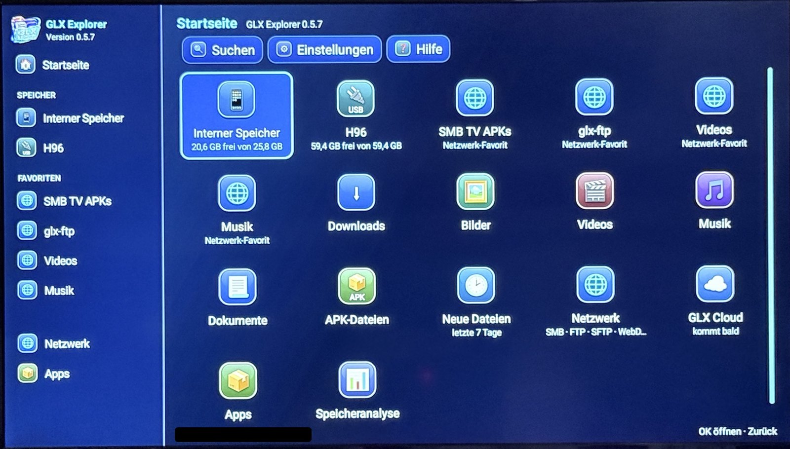
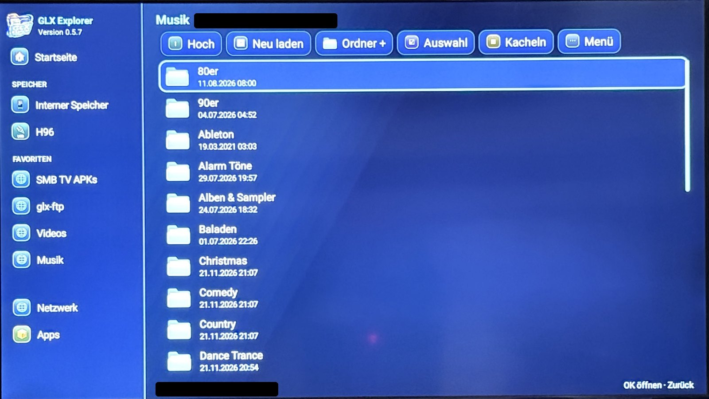
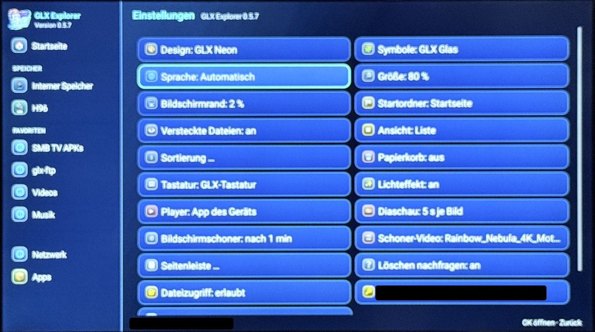
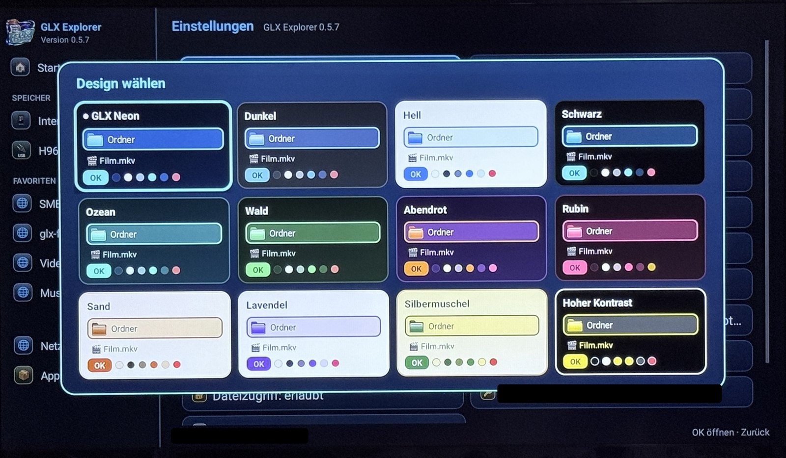
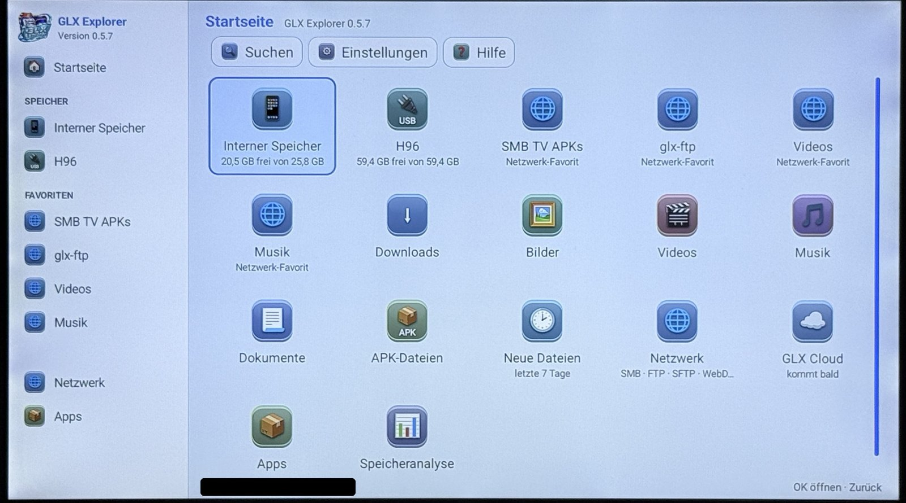

🌍 Sprachen: [🇺🇸 English](README.md) | [🇩🇪 Deutsch](README.de.md)

# 💠 GLX Explorer TV

### Der Dateimanager für deinen Android-Fernseher.

*Interner Speicher, USB-Sticks, Festplatten und dein Netzwerk an einem Ort, komplett mit der Fernbedienung bedienbar.* ⚡

   

---

## ⬇️ Download

👉 Neueste Version: [Releases](../../releases/latest)  
👉 Shop und Lizenzen: [glx-tools.de](https://glx-tools.de/product/glx-explorer-tv/)

---

## 📖 Über GLX Explorer TV

### Der Dateimanager für Android TV

GLX Explorer TV bringt endlich einen richtigen Dateimanager auf deinen Fernseher. Alles ist für die Fernbedienung gemacht: Steuerkreuz, OK und Zurück reichen für jede Funktion. Maus und Touch funktionieren auf Wunsch genauso. Große, klare Kacheln, gut lesbar vom Sofa aus.

### Alle Speicher auf einen Blick

Die Startseite zeigt internen Speicher, USB-Sticks, externe Festplatten und Speicherkarten mit freiem Platz. Dazu Kacheln für Downloads, Bilder, Videos, Musik, Dokumente, APK-Dateien und die neuesten Dateien der letzten 7 Tage. Eigene Lieblingsordner legst du als Favoriten auf die Startseite und in die Seitenleiste, einen Startordner kannst du frei wählen.

### Netzwerk: NAS, PC und Server

Greife direkt vom Fernseher auf deine Daten im Heimnetz zu: Windows-Freigaben und NAS über SMB (SMB 1 bis 3), FTP, FTPS, SFTP und WebDAV mit http und https. Die Suche im Heimnetz findet PCs, NAS und Server von selbst. Netzwerkordner lassen sich als Favorit oder Startordner merken.

### Filme und Musik direkt vom NAS

Videos und Musik spielen direkt vom Server im Player deines Fernsehers, ohne vorher alles zu kopieren. Vor- und Zurückspulen funktioniert dabei ganz normal. Bilder und Texte aus dem Netzwerk öffnest du sofort.

### Kopieren, Verschieben, Ordnen

Kopieren, Ausschneiden, Einfügen, Umbenennen, Löschen, neuer Ordner und neue Textdatei, für einzelne Dateien oder eine ganze Auswahl. Das geht zwischen Fernseher, USB-Stick und Netzwerk in alle Richtungen. Mit „Aufnehmen und Ablegen“ gibt es Ziehen und Ablegen für die Fernbedienung: Datei aufnehmen, zum Ziel gehen, ablegen. Gibt es eine Datei schon, fragt GLX Explorer TV, ob du überschreiben, überspringen oder beide behalten willst.

### Papierkorb, ZIP und Suche

Gelöschte Dateien landen erst im Papierkorb und lassen sich wiederherstellen. ZIP-Dateien packst und entpackst du direkt am Fernseher. Dazu Suche, Sortierung, Listen- oder Kachelansicht und auf Wunsch versteckte Dateien.

### Ansehen und Öffnen

Bilder zeigt GLX Explorer TV selbst an und blättert mit dem Steuerkreuz. Texte lassen sich lesen und bearbeiten. Videos und Musik öffnen im Player des Fernsehers, mit „Öffnen mit“ wählst du die App selbst.

### Teilen mit Direkt-Download

„Link teilen“ erzeugt einen Download-Link für eine Datei, auch für Dateien vom NAS. Jeder im Heimnetz lädt sie damit direkt im Browser herunter. Ablaufzeit 1 Stunde, 24 Stunden oder 7 Tage, wahlweise mit Passwort.

### Apps und Speicheranalyse

Installierte Apps starten, deinstallieren oder als APK sichern. APK-Dateien zeigen gleich das echte App-Symbol mit Name und Version und lassen sich mit einem Klick installieren. Die Speicheranalyse zeigt, welche Ordner und Dateien am meisten Platz belegen.

### Passt auf jeden Fernseher

Größe in 5-%-Schritten von 60 bis 130 % und ein einstellbarer Bildschirmrand, damit am Fernseher nichts abgeschnitten wird. Die Seitenleiste stellst du per Häkchen selbst zusammen. 12 GLX-Designs mit 3D-Symbolen, Oberfläche auf Deutsch und Englisch, Hilfe eingebaut.

### Immer aktuell

GLX Explorer TV meldet neue Versionen direkt am Fernseher. Mit einem Klick wird das Update geladen und über die alte Version installiert, deine Einstellungen bleiben erhalten.

### 14 Tage kostenlos testen

Teste 14 Tage lang alles ohne Einschränkung. Danach schaltest du GLX Explorer TV mit deinem Lizenzschlüssel frei. Ohne Lizenz sind nach der Testzeit nur Netzwerk, GLX Cloud und Netzwerk-Verknüpfungen gesperrt. Interner Speicher und USB-Sticks funktionieren immer, mit allen Funktionen und dauerhaft kostenlos.

---

## 📸 Überblick & Screenshots

### 1️⃣ Startseite mit Speichern, Favoriten und Kategorien

### 2️⃣ Netzwerkordner (SMB) mit der Fernbedienung durchsuchen

### 3️⃣ Einstellungen: Design, Größe, Player, Bildschirmschoner und mehr

### 4️⃣ 12 Designs zur Auswahl

### 5️⃣ Startseite im hellen Design

---

## ✨ Funktionen

- 🚀 **Für die Fernbedienung:** Steuerkreuz, OK und Zurück reichen für jede Funktion. Maus und Touch gehen auch.
- 🧩 **Alle Speicher im Blick:** Interner Speicher, USB-Sticks, externe Festplatten und Speicherkarten mit freiem Platz.
- ⚙️ **Netzwerk:** Windows-Freigaben (SMB), FTP, SFTP und WebDAV.
- 🔒 **Dateiwerkzeuge:** Dateien kopieren, verschieben, packen und teilen.
- 📂 **Abspielen vom NAS:** Videos und Musik direkt aus dem Netzwerk abspielen.
- ⚡ **12 Designs:** Wähle deinen Lieblingslook.
- 🎨 **Zwei Sprachen:** Deutsch und Englisch.

---

## 🧩 Systemanforderungen

- Android TV oder Google TV

---

## 🧪 Testzeitraum & Lizenz

14 Tage kostenlos mit allen Funktionen, danach eine Lizenz (19,99 Euro) über [glx-tools.de](https://glx-tools.de).

---

## 🔗 Mehr zu diesem Produkt

👉 [glx-tools.de](https://glx-tools.de/product/glx-explorer-tv/)  
Support: **info@glx-tools.de**

---

## 📄 Lizenz

Copyright © 2026 GLX Tools – Gordon Lehmann. Alle Rechte vorbehalten.  
Dies ist proprietäre kommerzielle Software. Es wird keine Open-Source-Lizenz gewährt. Dieses Repository enthält nur Release-Downloads und Dokumentation; der Quelltext wird nicht veröffentlicht.

---

Mit ❤️ gemacht von **Dreamdancer100**

