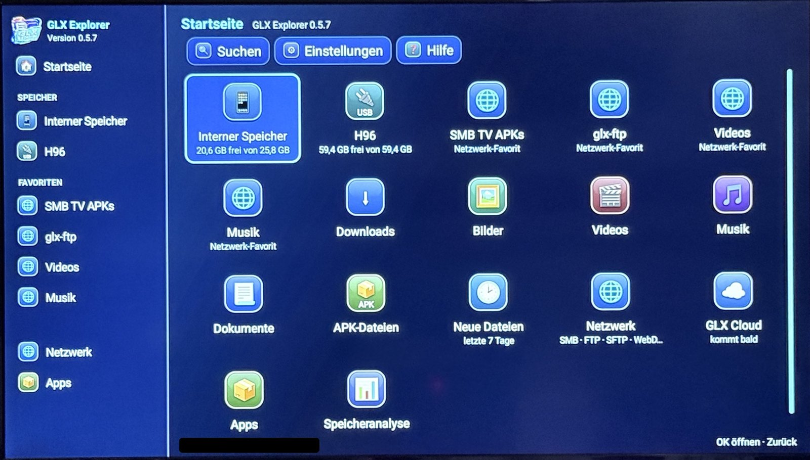
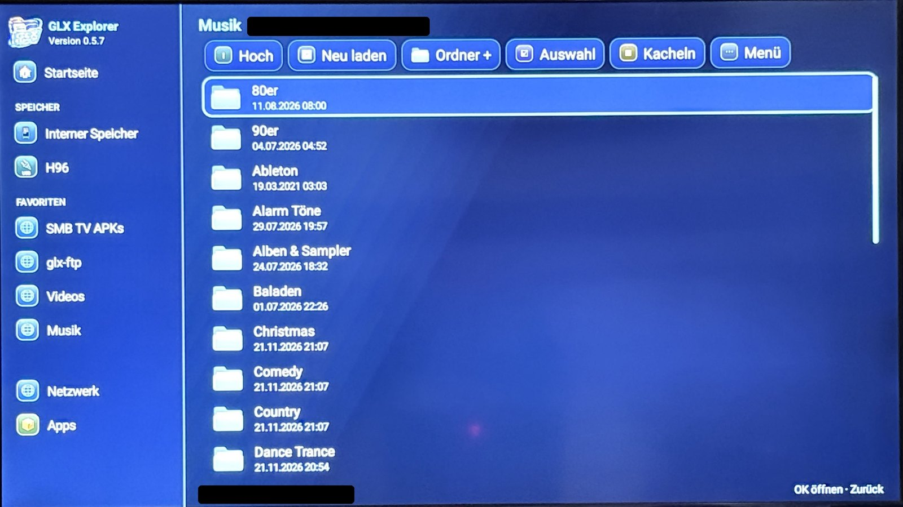
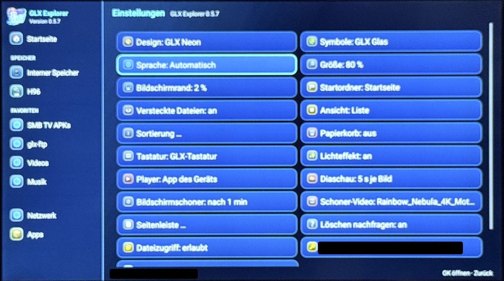
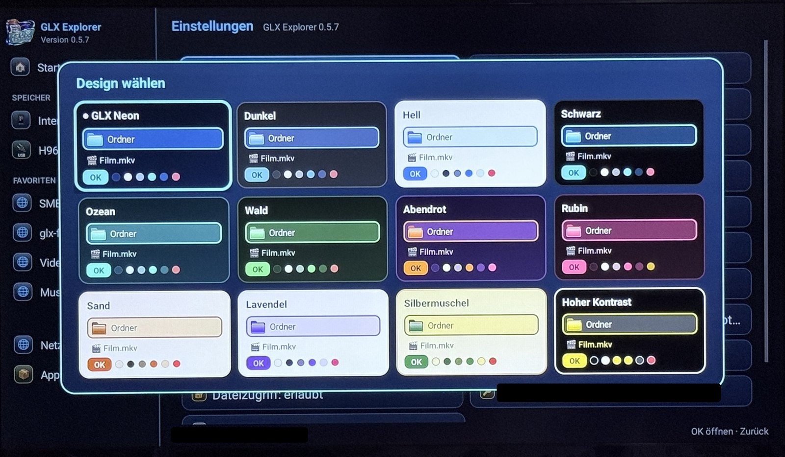
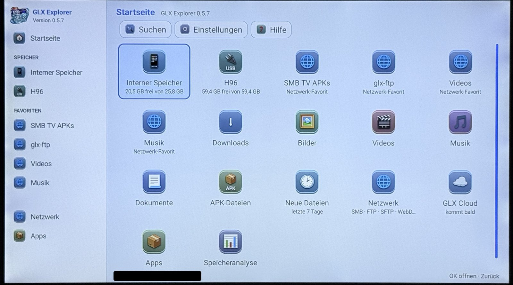

🌍 Languages: [🇺🇸 English](README.md) | [🇩🇪 Deutsch](README.de.md)

# 💠 GLX Explorer TV

### The file manager for your Android TV.

*Internal storage, USB drives and your network in one place, fully usable with the TV remote.* ⚡

   

---

## ⬇️ Download

👉 Latest version: [Releases](../../releases/latest)  
👉 Shop and licences: [glx-tools.de](https://glx-tools.de/product/glx-explorer-tv/)

---

## 📖 About GLX Explorer TV

### The file manager for Android TV

GLX Explorer TV finally brings a real file manager to your TV. Everything is made for the remote: d-pad, OK and Back are enough for every function. Mouse and touch work just as well if you like. Large, clear tiles that are easy to read from the sofa.

### All storage at a glance

The start page shows internal storage, USB sticks, external drives and memory cards with free space. Plus tiles for downloads, pictures, videos, music, documents, APK files and the newest files of the last 7 days. Pin your favourite folders to the start page and the sidebar, and choose any start folder you like.

### Network: NAS, PC and server

Access your data in your home network straight from the TV: Windows shares and NAS via SMB (SMB 1 to 3), FTP, FTPS, SFTP and WebDAV over http and https. The network search finds PCs, NAS devices and servers by itself. Network folders can be saved as a favourite or start folder.

### Films and music straight from the NAS

Videos and music play straight from the server in your TV player, without copying everything first. Fast forward and rewind work as usual. Pictures and texts from the network open instantly.

### Copy, move, organise

Copy, cut, paste, rename, delete, new folder and new text file, for single files or a whole selection, between TV, USB stick and network in every direction. "Pick up and drop" brings drag and drop to the remote: pick up a file, go to the target, drop it. If a file already exists, GLX Explorer TV asks whether to overwrite, skip or keep both.

### Recycle bin, ZIP and search

Deleted files go to the recycle bin first and can be restored. Pack and unpack ZIP files right on the TV. Plus search, sorting, list or tile view and hidden files if you want them.

### View and open

GLX Explorer TV shows pictures itself and pages through them with the d-pad. Texts can be read and edited. Videos and music open in the TV player, and "Open with" lets you choose the app.

### Share with direct download

"Share link" creates a download link for a file, also for files on the NAS. Anyone in your home network can download it right in the browser. Expiry 1 hour, 24 hours or 7 days, optionally with a password.

### Apps and storage analysis

Start, uninstall or back up installed apps as APK. APK files show the real app icon with name and version and install with one click. The storage analysis shows which folders and files take up the most space.

### Fits every TV

Size in 5 % steps from 60 to 130 % and an adjustable screen margin, so nothing is cut off on the TV. You put the sidebar together yourself with check boxes. 12 GLX designs with 3D icons, German and English interface, built-in help.

### Always up to date

GLX Explorer TV reports new versions right on the TV. One click downloads the update and installs it over the old version, and your settings are kept.

### 14-day free trial

Try everything without limits for 14 days. After that you activate GLX Explorer TV with your licence key. Without a licence only network, GLX Cloud and network shortcuts are locked after the trial. Internal storage and USB sticks always work, with all features and free forever.

---

## 📸 Overview & Screenshots

### 1️⃣ Home screen with storage, favourites and categories

### 2️⃣ Browsing a network share (SMB) with the remote

### 3️⃣ Settings: design, size, player, screensaver and more

### 4️⃣ 12 designs to choose from

### 5️⃣ Home screen in the light design

---

## ✨ Features

- 🚀 **Made for the remote:** D-pad, OK and Back are enough for every function. Mouse and touch work too.
- 🧩 **All storage at a glance:** Internal storage, USB sticks, external drives and memory cards with free space.
- ⚙️ **Network:** Windows shares (SMB), FTP, SFTP and WebDAV.
- 🔒 **File tools:** Copy, move, zip and share files.
- 📂 **Play from the NAS:** Videos and music play straight from the network.
- ⚡ **12 designs:** Choose your favourite look.
- 🎨 **Two languages:** German and English.

---

## 🧩 Requirements

- Android TV or Google TV

---

## 🧪 Trial & License

14 days free with all features, then a licence (19.99 EUR) from [glx-tools.de](https://glx-tools.de).

---

## 🔗 More about this product

👉 [glx-tools.de](https://glx-tools.de/product/glx-explorer-tv/)  
For support: **info@glx-tools.de**

---

## 📄 License

Copyright © 2026 GLX Tools – Gordon Lehmann. All rights reserved.  
This is proprietary commercial software. No open-source license is granted. This repository contains release downloads and documentation only; the source code is not published.

---

Made with ❤️ by **Dreamdancer100**

